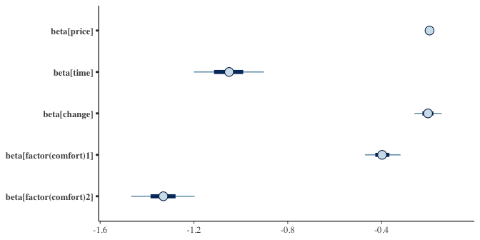

<!-- README.md is generated from README.Rmd. Please edit that file -->

# RprobitB <a href="https://loelschlaeger.de/RprobitB/"></a>

<!-- badges: start -->

[](https://CRAN.R-project.org/package=RprobitB)
[](https://github.com/loelschlaeger/RprobitB/actions/workflows/R-CMD-check.yaml)
[](https://app.codecov.io/gh/loelschlaeger/RprobitB)
<!-- badges: end -->

Discrete choice models explain decisions between mutually exclusive
alternatives through the utility a decider attaches to each of them.
**RprobitB** estimates such models in a Bayesian probit framework, for
binary, multinomial, ordered, and ranked responses, observed once per
decider or repeatedly in panel data. Preferences may vary across the
population, through random coefficients, latent classes, or both. The
posterior draws obtained from the Gibbs sampler support choice
prediction, marginal effects, and model comparison by information
criteria and Bayes factors.

## Installation

Install the released version from
[CRAN](https://CRAN.R-project.org/package=RprobitB):

``` r
install.packages("RprobitB")
```

## Example

We use 2929 stated choices by 235 Dutch individuals deciding between two
hypothetical train trip options `"A"` and `"B"` based on the price, the
travel time, the number of rail-to-rail transfers (changes), and the
level of comfort (where `0` is the best comfort and `2` the worst). The
data set `Train` of the
[**mlogit**](https://CRAN.R-project.org/package=mlogit) package records
the prices in cents of Dutch guilders and the travel times in minutes,
which we convert to euro and hours:

``` r
data("Train", package = "mlogit")
Train$price_A <- Train$price_A / 100 / 2.20371
Train$price_B <- Train$price_B / 100 / 2.20371
Train$time_A <- Train$time_A / 60
Train$time_B <- Train$time_B / 60
head(Train)
#>   choiceid id choice  price_A  price_B   time_A   time_B change_A change_B
#> 1        1  1      A 10.89073 18.15121 2.500000 2.500000        0        0
#> 2        2  1      A 10.89073 14.52097 2.500000 2.166667        0        0
#> 3        3  1      A 10.89073 18.15121 1.916667 1.916667        0        0
#> 4        4  1      B 18.15121 14.52097 2.166667 2.500000        0        0
#> 5        5  1      B 10.89073 14.52097 2.500000 2.500000        0        0
#> 6        6  1      B 18.15121 10.89073 1.916667 2.166667        0        0
#>   comfort_A comfort_B
#> 1         1         1
#> 2         1         1
#> 3         1         0
#> 4         1         0
#> 5         1         0
#> 6         0         0
```

Choice models in **RprobitB** are estimated with the function `fit()`:

``` r
library(RprobitB)
set.seed(1)
train_model <- fit(
  choice ~ price + time + change + factor(comfort) | 0, # model formula
  data = Train,                                         # choice data
  column_decider = "id",                                # decider identifiers
  column_occasion = "choiceid"                          # occasion identifiers
)
```

`summary()` reports the posterior together with convergence diagnostics:

``` r
summary(train_model)
#> Bayesian probit choice model
#> Formula: choice ~ price + time + change + factor(comfort) | 0 | 0 
#> Samples: 500 retained per chain, 4 chains
#> 
#>                variable   mean   mode      sd rhat ess_bulk
#>             beta[price] -0.195 -0.195 0.00891 1.00      477
#>              beta[time] -1.052 -1.054 0.09191 1.00      635
#>            beta[change] -0.202 -0.205 0.03546 1.00      714
#>  beta[factor(comfort)1] -0.397 -0.402 0.04602 1.01      685
#>  beta[factor(comfort)2] -1.331 -1.325 0.08050 1.00      678
```

`plot()` displays the results via
[**bayesplot**](https://mc-stan.org/bayesplot/):

``` r
plot(train_model, type = "interval")
```



The negative estimate signs indicate that a higher fare, a longer trip,
an extra change, and a poorer comfort class each lower the utility of an
alternative (as expected). Beyond the signs, the ratios of the
coefficients can be interpreted as trade-offs:

``` r
compensation <- interpret(train_model, reference = "price")
compensation
#> 1 `time` compensates -5.38 `price` (95% interval -6.22 to -4.55)
#> 1 `change` compensates -1.04 `price` (95% interval -1.39 to -0.679)
#> 1 `factor(comfort)1` compensates -2.03 `price` (95% interval -2.46 to -1.58)
#> 1 `factor(comfort)2` compensates -6.82 `price` (95% interval -7.62 to -6.04)
```

Read this way, deciders would pay

- 5.38 euro to save one hour of travel time,
- 1.04 euro to avoid one change of train,
- 2.03 euro for the highest comfort class instead of the middle one, and
- 6.82 euro for the highest comfort class instead of the lowest.

The fitted model can also be used to predict choices for trips that the
data do not contain. Below, trip `"B"` saves an hour over trip `"A"` and
charges a premium of 2, 5, or 8 euro for it:

``` r
scenario <- data.frame(
  price_A = 20,  price_B = c(22, 25, 28),
  time_A = 2.5,  time_B = 1.5,
  change_A = 0,  change_B = 0,
  comfort_A = 1, comfort_B = 1
)
predict(train_model, newdata = scenario)
#>   id choiceid .prediction probability_A probability_B
#> 1  1        1           B     0.2551518     0.7448482
#> 2  2        1           B     0.4703257     0.5296743
#> 3  3        1           A     0.6947358     0.3052642
```

The prediction turns where the premium passes the 5.38 euro that the
hour is worth: the faster trip is the predicted choice at 2 euro, the
two are almost tied at 5 euro, and the slower trip wins at 8 euro.

Besides prices, are the other three choice attributes worth modeling at
all? `update()` refits the model with a changed specification on the
same data, and `bayes_factor()` compares the two:

``` r
train_model_small <- update(train_model, . ~ price) # using only price
comparison <- bayes_factor(train_model, train_model_small, log = TRUE)
comparison
#> Estimated log Bayes factor in favor of model1 over model2: 150.68215
```

The log Bayes factor of 151 is decisive: travel time, changes, and
comfort carry information about the choices that the price alone does
not.

## What the package covers

The **RprobitB** function `fit()` estimates the following model
variants:

- binary, multinomial, ordered, and ranked responses,
- cross-sectional and panel data,
- correlated or uncorrelated normal or log-normal random effects,
- latent classes with a fixed, sparse finite, or Dirichlet-process based
  number of components.

Five vignettes cover the details:

- **[Get
  started](https://loelschlaeger.de/RprobitB/articles/v01_get_started.html)**
  fits a first model and walks through summaries, convergence
  diagnostics, plots, the posterior draws, and running chains in
  parallel.
- **[Model specification and
  variants](https://loelschlaeger.de/RprobitB/articles/v02_model_variants.html)**
  covers the model normalization, the prior, the three covariate types,
  individual choice sets, and ordered and ranked responses.
- **[Modeling preference
  heterogeneity](https://loelschlaeger.de/RprobitB/articles/v03_heterogeneity.html)**
  covers random coefficients with six mixing distributions and latent
  classes with a fixed, sparse finite, or Dirichlet-process based number
  of components.
- **[Posterior
  prediction](https://loelschlaeger.de/RprobitB/articles/v04_prediction.html)**
  covers predictions for the population and for individual deciders,
  scenarios for new data, residuals, and marginal effects.
- **[Bayesian model
  evaluation](https://loelschlaeger.de/RprobitB/articles/v05_model_evaluation.html)**
  covers model comparison via WAIC, PSIS-LOO, and Bayes factors.

Posterior draws are stored in the
[**posterior**](https://mc-stan.org/posterior/) format. Chains can run
in parallel through a [**future**](https://doi.org/10.32614/RJ-2021-048)
plan. The examples use data sets of the
[**mlogit**](https://CRAN.R-project.org/package=mlogit),
[**AER**](https://CRAN.R-project.org/package=AER),
[**MASS**](https://CRAN.R-project.org/package=MASS), and
[**choicedata**](https://github.com/loelschlaeger/choicedata) packages,
which are introduced in the vignettes.

## Citation

``` r
citation("RprobitB")
#> To cite package 'RprobitB' in publications use:
#> 
#>   Oelschläger L, Bauer D (2026). _RprobitB: Bayesian Probit Choice
#>   Modeling_. R package version 2.0.1,
#>   <https://loelschlaeger.de/RprobitB/>.
#> 
#> A BibTeX entry for LaTeX users is
#> 
#>   @Manual{,
#>     title = {RprobitB: Bayesian Probit Choice Modeling},
#>     author = {Lennart Oelschläger and Dietmar Bauer},
#>     year = {2026},
#>     note = {R package version 2.0.1},
#>     url = {https://loelschlaeger.de/RprobitB/},
#>   }
```

The broader methodological foundation is described in Oelschläger
(2026), *Overcoming Challenges in Modeling Choice Behavior
Heterogeneity*, doctoral dissertation, Bielefeld University,
<https://pub.uni-bielefeld.de/record/3014719>. The latent-class mixed
multinomial probit model is described in Oelschläger and Bauer (2021),
*Bayes Estimation of Latent Class Mixed Multinomial Probit Models*, TRB
Annual Meeting 2021, <https://trid.trb.org/view/1759753>.
