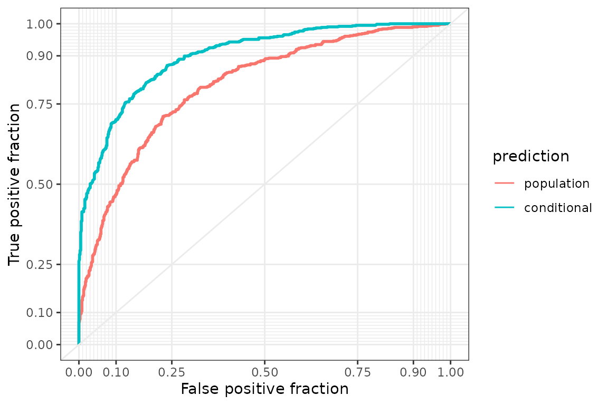

# Posterior prediction

A fitted choice model answers questions about choice probabilities:
which of two train trips a traveler is likely to book, how the support
for a wind-power project changes with the compensation, and how well the
model predicts the choices of deciders that were not used for
estimation. In the probit model introduced in the vignette [Get started
with
RprobitB](https://loelschlaeger.de/RprobitB/articles/v01_get_started.html),
the choice probability of an alternative is the probability that its
latent utility exceeds the utilities of the other alternatives, and it
depends on the covariates of the occasion and on the parameters.
[`predict()`](https://rdrr.io/r/stats/predict.html) evaluates these
probabilities under every retained posterior draw and averages them, so
that the predictions account for the posterior uncertainty about the
parameters ([Gelman et al. 1996](#ref-Gelman1996)). This vignette covers
predictions for the population and for individual deciders, scenarios,
out-of-sample prediction, residuals, and marginal effects. The examples
use data sets of the **mlogit** package ([Croissant
2020](#ref-Croissant2020)), the **choicedata** package ([Oelschläger
2026](#ref-Oelschlaeger2026a)), and the **MASS** package ([Venables and
Ripley 2002](#ref-VenablesRipley2002)).

``` r

library(RprobitB)
set.seed(1)
```

## A random price coefficient

The `Train` data of the **mlogit** package contain about a dozen choices
by each of 235 Dutch travelers between two hypothetical train trips that
differ in price, travel time, number of changes, and comfort class
([Ben-Akiva et al. 1993](#ref-BenAkiva1993)). As in the vignette [Get
started with
RprobitB](https://loelschlaeger.de/RprobitB/articles/v01_get_started.html),
the prices are converted to euro and the travel times to hours. That
vignette fits one price coefficient for all travelers. Here the price
coefficient is a normal random effect, as introduced in the vignette
[Modeling preference
heterogeneity](https://loelschlaeger.de/RprobitB/articles/v03_heterogeneity.html):
every traveler has an individual price coefficient, drawn from a normal
population distribution whose mean and variance are estimated. The fit
uses the first 100 travelers. The individual draws are saved because the
conditional predictions below use them, and thinning keeps 100 draws in
total, which keeps the predictions fast.

``` r

data("Train", package = "mlogit")
Train$price_A <- Train$price_A / 100 / 2.20371
Train$price_B <- Train$price_B / 100 / 2.20371
Train$time_A <- Train$time_A / 60
Train$time_B <- Train$time_B / 60
train_small <- Train[Train$id %in% unique(Train$id)[1:100], ]
model <- fit(
  choice ~ price + time + change + factor(comfort) | 0,
  data = train_small,
  random_effects = "price",
  column_decider = "id",
  column_occasion = "choiceid",
  iterations = 1500,
  warmup = 750,
  thin = 15,
  chains = 2,
  save_individual_draws = TRUE,
  progress = FALSE
)
summary(model)
#> Bayesian probit choice model
#> Formula: choice ~ price + time + change + factor(comfort) | 0 | 0 
#> Samples: 50 retained per chain, 2 chains
#> 
#>                variable   mean   mode     sd  rhat ess_bulk
#>              beta[time] -2.061 -2.096 0.2040 0.997     80.6
#>            beta[change] -0.348 -0.347 0.0581 1.019    124.6
#>  beta[factor(comfort)1] -0.675 -0.702 0.0880 0.997     81.7
#>  beta[factor(comfort)2] -2.155 -2.134 0.1921 0.992     95.8
#>               mu[price] -0.470 -0.492 0.0461 1.012     99.2
#>      Omega[price,price]  0.137  0.121 0.0320 1.017     35.6
```

`mu[price]` and `Omega[price,price]` are the mean and the variance of
the price coefficient across the population. Price sensitivity differs
considerably between travelers, which the predictions below take into
account.

## Population predictions

By default, [`predict()`](https://rdrr.io/r/stats/predict.html) returns
one row per choice occasion with the identifiers, the most probable
alternative in `.prediction`, and the posterior mean probability of
every alternative. These population predictions integrate over the
estimated population distribution of the random coefficient, so they
apply to any traveler from the population.

``` r

population <- predict(model)
head(population)
#>   id choiceid .prediction probability_A probability_B
#> 1  1        1           A     0.8831176     0.1168824
#> 2  1        2           A     0.7286351     0.2713649
#> 3  1        3           A     0.8307900     0.1692100
#> 4  1        4           B     0.1564283     0.8435717
#> 5  1        5           A     0.7309613     0.2690387
#> 6  1        6           B     0.1555722     0.8444278
```

`uncertainty = TRUE` adds the posterior standard deviation and an
equal-tailed credible interval of every probability, here at the 90%
level. The intervals reflect the posterior uncertainty about the
parameters.

``` r

head(predict(model, uncertainty = TRUE, level = 0.9))
#>   id choiceid .prediction probability_A probability_B       sd_A       sd_B
#> 1  1        1           A     0.8831176     0.1168824 0.02856514 0.02856514
#> 2  1        2           A     0.7286351     0.2713649 0.02988624 0.02988624
#> 3  1        3           A     0.8307900     0.1692100 0.03299359 0.03299359
#> 4  1        4           B     0.1564283     0.8435717 0.02815530 0.02815530
#> 5  1        5           A     0.7309613     0.2690387 0.03237293 0.03237293
#> 6  1        6           B     0.1555722     0.8444278 0.03153192 0.03153192
#>     lower_A    lower_B   upper_A   upper_B
#> 1 0.8288982 0.07442425 0.9255757 0.1711018
#> 2 0.6742942 0.22409280 0.7759072 0.3257058
#> 3 0.7730941 0.11706429 0.8829357 0.2269059
#> 4 0.1189039 0.78948827 0.2105117 0.8810961
#> 5 0.6786981 0.22029219 0.7797078 0.3213019
#> 6 0.1083628 0.78667999 0.2133200 0.8916372
```

## Conditional predictions for fitted deciders

The dozen choices of a traveler are informative about their individual
price coefficient. `coef(level = "individual")` returns the posterior
mean of every traveler’s coefficient, and
`predict(type = "conditional")` uses the individual draws instead of the
population distribution. Conditional predictions exist only for the
deciders in the fitted data, and they are usually sharper because they
use the decider’s own choices. This partial pooling is the main argument
for hierarchical Bayesian choice models ([Allenby and Rossi
1998](#ref-Allenby1998); [Huber and Train 2001](#ref-Huber2001)).

``` r

head(coef(model, level = "individual"))
#>         price
#> 1 -0.26656892
#> 2 -0.88587512
#> 3 -0.72677872
#> 4 -0.45796939
#> 5 -0.02111384
#> 6 -0.06105135
conditional <- predict(model, type = "conditional")
head(conditional)
#>   id choiceid .prediction probability_A probability_B
#> 1  1        1           A     0.9514486     0.0485514
#> 2  1        2           A     0.6045667     0.3954333
#> 3  1        3           A     0.8572995     0.1427005
#> 4  1        4           B     0.1814329     0.8185671
#> 5  1        5           A     0.6087101     0.3912899
#> 6  1        6           B     0.1130333     0.8869667
```

The hit rate, the share of correctly predicted choices in the fitted
data, is one measure of the gain:

``` r

observed <- model.frame(model)$choice
c(
  population = mean(population$.prediction == observed, na.rm = TRUE),
  conditional = mean(conditional$.prediction == observed, na.rm = TRUE)
)
#>  population conditional 
#>    0.733871    0.816129
```

The hit rate evaluates the predictions at a single threshold, a
probability of one half. An ROC curve compares them at every threshold:
as the threshold for predicting trip `B` decreases from one to zero, the
curve plots the share of `B` choices predicted correctly against the
share of `A` choices wrongly predicted as `B`. The **plotROC** package
([Sachs 2017](#ref-Sachs2017)) draws the curves with **ggplot2**
([Wickham 2016](#ref-Wickham2016)).

``` r

library(ggplot2)
library(plotROC)
roc_data <- rbind(
  data.frame(
    prediction = "population", chose_B = as.integer(observed == "B"),
    probability = population$probability_B
  ),
  data.frame(
    prediction = "conditional", chose_B = as.integer(observed == "B"),
    probability = conditional$probability_B
  )
)
roc_data$prediction <- factor(
  roc_data$prediction, levels = c("population", "conditional")
)
roc_plot <- ggplot(
  roc_data, aes(d = chose_B, m = probability, color = prediction)
) +
  geom_roc(n.cuts = 0) +
  style_roc()
roc_plot
```



The conditional curve lies above the population curve and therefore has
the larger area under the curve, which equals one for a perfect and one
half for an uninformative prediction.

## Scenario analysis in a stated choice experiment

A scenario predicts the choice probabilities for modified attributes.
Near Setskog in Norway, 308 residents were asked six times to choose
between two plans for a proposed wind-power project and the status quo
without the project, alternative `1` ([Dugstad et al.
2024](#ref-Dugstad2024)). The plans varied the number and height of the
turbines, the routing of the power line, and an annual reduction in
municipal taxes offered as compensation. The study also measured each
respondent’s collective psychological ownership of the affected area, a
standardized score of how strongly they feel that the landscape belongs
to the residents. The score does not vary across alternatives and
therefore enters the second part of the formula, which gives it one
coefficient per plan relative to the status quo. The fit uses the first
150 respondents.

``` r

wind_formula <- choice ~ turbines + height + powerline + compensation |
  psychological_ownership
```

``` r

data("wind_power_choice", package = "choicedata")
respondents <- unique(wind_power_choice$respondent)[1:150]
wind_small <- wind_power_choice[
  wind_power_choice$respondent %in% respondents,
]
wind <- fit(
  formula = wind_formula,
  data = wind_small,
  column_decider = "respondent",
  column_occasion = "occasion",
  iterations = 10000,
  warmup = 5000,
  thin = 10,
  chains = 1,
  progress = FALSE
)
coef(wind)[c("beta[compensation]", "beta[psychological_ownership_2]")]
#>              beta[compensation] beta[psychological_ownership_2] 
#>                     0.001323216                    -0.484861950
```

The compensation coefficient is positive and the ownership coefficient
negative: compensation makes a plan more attractive, and residents with
a stronger feeling of ownership are less willing to leave the status
quo.

What would happen if the municipality doubled the compensation?
`newdata` accepts a data frame in the layout of the fitted data, with or
without the response column. The scenario below doubles the compensation
of both plans in the first four choice tasks and compares the
probability of the status quo before and after.

``` r

tasks <- model.frame(wind)[1:4, ]
tasks$choice <- NULL
scenario <- tasks
scenario$compensation_2 <- 2 * scenario$compensation_2
scenario$compensation_3 <- 2 * scenario$compensation_3
cbind(
  before = predict(wind, newdata = tasks)$probability_1,
  after = predict(wind, newdata = scenario)$probability_1
)
#>         before     after
#> [1,] 0.3166753 0.1740325
#> [2,] 0.2841614 0.1715989
#> [3,] 0.2929244 0.2167170
#> [4,] 0.3511169 0.2747030
```

Doubling the compensation lowers the probability of the status quo in
all four tasks.

## Out-of-sample prediction and calibration

Predictive performance is best judged on deciders that were not used for
estimation ([Vehtari et al. 2017](#ref-Vehtari2017)). In an arena
tournament on the chess server Lichess, a player may go Berserk at the
start of a game: the clock is halved, and a win earns one extra
tournament point. Players on a winning streak collect double points, so
a loss is more costly for them. The `lichess_berserk_choice` data of the
**choicedata** package record this decision for 5852 players in the
Lichess Yearly Rapid Arena of April 2026, game by game, together with
the playing color, the player’s rating, the rating difference to the
opponent, the remaining tournament time, and whether the player was on a
streak. All covariates describe the game and are constant across the two
alternatives, so they enter the second part of the formula, which gives
each of them one coefficient for the alternative `TRUE` relative to
`FALSE`, for example `beta[rating_TRUE]`. Logical covariates appear as
dummy variables such as `streakTRUE`.

``` r

berserk_formula <- berserk ~ 0 | white + rating + ratingDifference +
  minutesRemaining + streak
```

The fit uses the games of the first 300 players.
[`train_test()`](https://loelschlaeger.de/choicedata/reference/train_test.html)
splits them by decider: `test_number = 60` puts all games of 60 players
into the test set and the games of the other players into the training
set.

``` r

data("lichess_berserk_choice", package = "choicedata")
players <- unique(lichess_berserk_choice$deciderID)
first_players <- lichess_berserk_choice$deciderID %in% players[1:300]
split <- train_test(lichess_berserk_choice[first_players, ], test_number = 60)
berserk <- fit(
  formula = berserk_formula,
  data = split$train,
  column_occasion = "occasionID",
  iterations = 1000,
  warmup = 500,
  chains = 2,
  progress = FALSE
)
coef(berserk)
#>        beta[whiteTRUE_TRUE]           beta[rating_TRUE] 
#>                2.828675e-02                1.460691e-03 
#> beta[ratingDifference_TRUE] beta[minutesRemaining_TRUE] 
#>                6.888317e-05               -1.958756e-04 
#>       beta[streakTRUE_TRUE]              beta[ASC_TRUE] 
#>               -7.880141e-02               -3.172163e+00
```

The rating coefficient is positive: stronger players go Berserk more
often. The coefficients of the streak and of the remaining time are
negative. How well does the model predict the games of the 60 players in
the test set? `newdata` takes the test set as it is, and the predicted
alternative is compared with the observed one.

``` r

holdout_prediction <- predict(berserk, newdata = split$test)
holdout_choice <- as.character(split$test$berserk)
c(
  accuracy = mean(holdout_prediction$.prediction == holdout_choice),
  share_berserk = mean(split$test$berserk)
)
#>      accuracy share_berserk 
#>     0.6810700     0.3497942
```

The hit rate is only slightly higher than the share of games without
Berserk, which the rule that never predicts Berserk would already reach,
so the hit rate alone is a weak criterion for an unbalanced binary
response. A calibration analysis assesses the predicted probabilities
instead. It groups the hold-out games by predicted Berserk probability
in intervals of width 0.1 and compares the mean predicted probability
with the observed Berserk rate in each group; groups with fewer than 50
games are dropped.

``` r

predicted <- holdout_prediction$probability_TRUE
bins <- cut(predicted, breaks = seq(0, 1, by = 0.1))
calibration <- data.frame(
  games = as.vector(table(bins)),
  predicted = as.vector(tapply(predicted, bins, mean)),
  observed = as.vector(tapply(split$test$berserk, bins, mean)),
  row.names = levels(bins)
)
large <- calibration[calibration$games >= 50, ]
round(large, 2)
#>           games predicted observed
#> (0.1,0.2]    58      0.14     0.17
#> (0.2,0.3]   196      0.25     0.25
#> (0.3,0.4]    80      0.35     0.35
#> (0.4,0.5]    81      0.43     0.57
```

The calibration plot shows the same table. Points on the diagonal mean
that the predicted probability equals the observed rate, and the point
sizes are proportional to the number of games in a group.

``` r

plot(
  large$predicted, large$observed,
  xlim = c(0, 1), ylim = c(0, 1), pch = 19,
  cex = 0.5 + 2 * large$games / max(large$games),
  xlab = "predicted Berserk probability",
  ylab = "observed Berserk rate"
)
abline(0, 1, lwd = 2, col = "grey50")
```


The observed Berserk rate rises with the predicted probability, so the
model orders the games by their Berserk rate. In the group with the
highest predictions, the observed rate exceeds the predicted
probability, so the model underpredicts Berserk for these games.

## Residuals

[`residuals()`](https://rdrr.io/r/stats/residuals.html) returns the
observed choice indicators minus the posterior mean probabilities, one
row per choice occasion and one column per alternative. The rows of
observed occasions sum to zero, and occasions with a missing response
yield `NA`. A single residual is uninformative, because the indicator is
zero or one while the probability lies in between, so the residuals are
averaged over groups of occasions. The average residual per traveler
shows whose choices the model reproduces:

``` r

model_residuals <- residuals(model)
head(model_residuals)
#>              A          B
#> 1:1  0.1168824 -0.1168824
#> 1:2  0.2713649 -0.2713649
#> 1:3  0.1692100 -0.1692100
#> 1:4 -0.1564283  0.1564283
#> 1:5 -0.7309613  0.7309613
#> 1:6 -0.1555722  0.1555722
by_decider <- tapply(
  model_residuals[, "A"], model.frame(model)$id, mean, na.rm = TRUE
)
round(quantile(by_decider, c(0, 0.25, 0.5, 0.75, 1)), 3)
#>     0%    25%    50%    75%   100% 
#> -0.340 -0.066 -0.006  0.067  0.344
```

Most travelers have an average residual close to zero. For the travelers
at the extremes, the model predicts trip `A` too often or too rarely
across all their questions. Grouping by a covariate checks the
functional form instead, here by the price of trip `A` in four groups of
equal size:

``` r

price_group <- cut(
  model.frame(model)$price_A,
  breaks = quantile(model.frame(model)$price_A, seq(0, 1, 0.25)),
  include.lowest = TRUE
)
round(tapply(model_residuals[, "A"], price_group, mean, na.rm = TRUE), 3)
#> [0.454,11.2]  (11.2,14.5]  (14.5,18.2]  (18.2,56.7] 
#>        0.024        0.000        0.008       -0.010
```

All four group averages are close to zero. A systematic pattern, for
example positive residuals at both ends, would indicate a nonlinear
price effect or an unmodeled preference class.

## Marginal effects

How much does one euro more change the probability of booking a trip?
The coefficients do not answer this directly, because the probit link is
nonlinear: the same change of a covariate moves the probability most
where the alternatives are close in utility and little where one
alternative dominates.
[`interpret()`](https://loelschlaeger.de/RprobitB/reference/interpret.md)
therefore differentiates the predicted probabilities numerically.
`type = "mea"` evaluates the derivative for one occasion whose
covariates equal the observed averages, reported in the column `at`.
`type = "ame"` evaluates the derivative for every observed occasion and
averages, which weights the occasions as they occur in the data. Both
use every posterior draw and therefore come with credible intervals.

``` r

interpret(model, type = "mea")
#> Marginal effects at the average covariate values
#> Change in the probability of the alternative per unit of the covariate, with 95% interval 
#>  covariate alternative     at   mean     sd  lower   upper
#>       time           A  2.115 -0.822 0.0813 -0.961 -0.6776
#>       time           B  2.105 -0.822 0.0813 -0.961 -0.6776
#>     change           A  0.652 -0.139 0.0231 -0.191 -0.0915
#>     change           B  0.679 -0.139 0.0231 -0.191 -0.0915
#>      price           A 15.452 -0.187 0.0184 -0.218 -0.1592
#>      price           B 15.523 -0.187 0.0184 -0.218 -0.1592
average_effects <- interpret(model, type = "ame")
average_effects
#> Average marginal effects on the choice probabilities
#> Change in the probability of the alternative per unit of the covariate, with 95% interval 
#>  covariate alternative    mean      sd   lower   upper
#>       time           A -0.4555 0.03649 -0.5229 -0.3922
#>       time           B -0.4555 0.03649 -0.5229 -0.3922
#>     change           A -0.0770 0.01234 -0.1038 -0.0515
#>     change           B -0.0770 0.01234 -0.1038 -0.0515
#>      price           A -0.0865 0.00604 -0.0969 -0.0752
#>      price           B -0.0865 0.00604 -0.0969 -0.0752
```

Averaged over the observed occasions, one euro more lowers the
probability of a trip by about 9 percentage points and one hour more by
about 46 percentage points.

The `at` argument replaces the averages of selected covariates. A much
cheaper trip `B` moves its probability close to one, where one euro more
changes it only marginally:

``` r

interpret(model, type = "mea", at = c(price_A = 30, price_B = 10))
#> Marginal effects at the given covariate values
#> Change in the probability of the alternative per unit of the covariate, with 95% interval 
#>  covariate alternative     at      mean       sd     lower     upper
#>       time           A  2.115 -0.048781 7.35e-03 -0.064862 -0.035414
#>       time           B  2.105 -0.048781 7.35e-03 -0.064862 -0.035414
#>     change           A  0.652 -0.008225 1.60e-03 -0.011192 -0.005565
#>     change           B  0.679 -0.008225 1.60e-03 -0.011192 -0.005565
#>      price           A 30.000 -0.000191 3.96e-05 -0.000281 -0.000131
#>      price           B 10.000 -0.000191 3.96e-05 -0.000281 -0.000131
```

## Predictions for ordered responses

An ordered model compares one latent utility per occasion with
increasing thresholds that partition it into the levels of the response,
as the vignette [Model specification and
variants](https://loelschlaeger.de/RprobitB/articles/v02_model_variants.html)
describes. For such a model,
[`predict()`](https://rdrr.io/r/stats/predict.html) returns the
probability of every level. The smoking model of that vignette predicts
how often a student smokes from their age and exercise habits.

``` r

data("survey", package = "MASS")
smoking <- fit(
  Smoke ~ Age + Exer,
  data = survey,
  alternatives = c("Never", "Occas", "Regul", "Heavy"),
  choice_type = "ordered",
  column_decider = NULL,
  chains = 1
)
head(predict(smoking))
#>   deciderID .prediction probability_Never probability_Occas probability_Regul
#> 1         1       Never         0.8562408        0.06475144        0.05073226
#> 2         2       Never         0.7956245        0.08255546        0.07279669
#> 3         3       Never         0.7965730        0.08223363        0.07243314
#> 4         4       Never         0.7914499        0.08388835        0.07437814
#> 5         5       Never         0.8484086        0.06746885        0.05373528
#> 6         6       Never         0.8524846        0.06610157        0.05217742
#>   probability_Heavy
#> 1        0.02827552
#> 2        0.04902336
#> 3        0.04876022
#> 4        0.05028357
#> 5        0.03038726
#> 6        0.02923643
```

Every row has four probabilities that sum to one, and `.prediction`
names the most probable level. Because most students never smoke, this
level is the most probable for almost every student, and the
probabilities are more informative than the predicted level. A scenario
works as before. Ten more years of age shift the probability of never
smoking of the first three students:

``` r

students <- model.frame(smoking)[1:3, ]
students$Smoke <- NULL
older <- students
older$Age <- older$Age + 10
cbind(
  before = predict(smoking, newdata = students)$probability_Never,
  after = predict(smoking, newdata = older)$probability_Never
)
#>         before     after
#> [1,] 0.8562408 0.8404168
#> [2,] 0.7956245 0.7784639
#> [3,] 0.7965730 0.7797745
```

The probabilities change only slightly, because the age coefficient is
small.

## Further reading

Predictions describe what a model expects, not whether it is better than
another model. That comparison is the subject of the vignette [Bayesian
model
evaluation](https://loelschlaeger.de/RprobitB/articles/v05_model_evaluation.html).

## References

Allenby, Greg M., and Peter E. Rossi. 1998. “Marketing Models of
Consumer Heterogeneity.” *Journal of Econometrics* 89 (1-2): 57–78.
<https://doi.org/10.1016/S0304-4076(98)00055-4>.

Ben-Akiva, Moshe, Denis Bolduc, and Mark Bradley. 1993. “Estimation of
Travel Choice Models with Randomly Distributed Values of Time.”
*Transportation Research Record* 1413: 88–97.
<https://trid.trb.org/View/385096>.

Croissant, Yves. 2020. “Estimation of Random Utility Models in R: The
mlogit Package.” *Journal of Statistical Software* 95 (11): 1–41.
<https://doi.org/10.18637/jss.v095.i11>.

Dugstad, Anders, Roy Brouwer, Kristine Grimsrud, Gorm Kipperberg, Henrik
Lindhjem, and Ståle Navrud. 2024. “Nature Is Ours! Psychological
Ownership and Preferences for Wind Energy.” *Energy Economics* 129:
107239. <https://doi.org/10.1016/j.eneco.2023.107239>.

Gelman, Andrew, Xiao-Li Meng, and Hal Stern. 1996. “Posterior Predictive
Assessment of Model Fitness via Realized Discrepancies.” *Statistica
Sinica* 6 (4): 733–807.
<https://www3.stat.sinica.edu.tw/statistica/j6n4/j6n41/j6n41.htm>.

Huber, Joel, and Kenneth Train. 2001. “On the Similarity of Classical
and Bayesian Estimates of Individual Mean Partworths.” *Marketing
Letters* 12 (3): 259–69. <https://doi.org/10.1023/A:1011120928698>.

Oelschläger, Lennart. 2026. *choicedata: Working with Choice Data*.
<https://doi.org/10.32614/CRAN.package.choicedata>.

Sachs, Michael C. 2017. “plotROC: A Tool for Plotting ROC Curves.”
*Journal of Statistical Software, Code Snippets* 79 (2): 1–19.
<https://doi.org/10.18637/jss.v079.c02>.

Vehtari, Aki, Andrew Gelman, and Jonah Gabry. 2017. “Practical Bayesian
Model Evaluation Using Leave-One-Out Cross-Validation and WAIC.”
*Statistics and Computing* 27 (5): 1413–32.
<https://doi.org/10.1007/s11222-016-9696-4>.

Venables, William N., and Brian D. Ripley. 2002. *Modern Applied
Statistics with s*. 4th ed. Springer.

Wickham, Hadley. 2016. *Ggplot2: Elegant Graphics for Data Analysis*.
Springer. <https://doi.org/10.1007/978-3-319-24277-4>.
